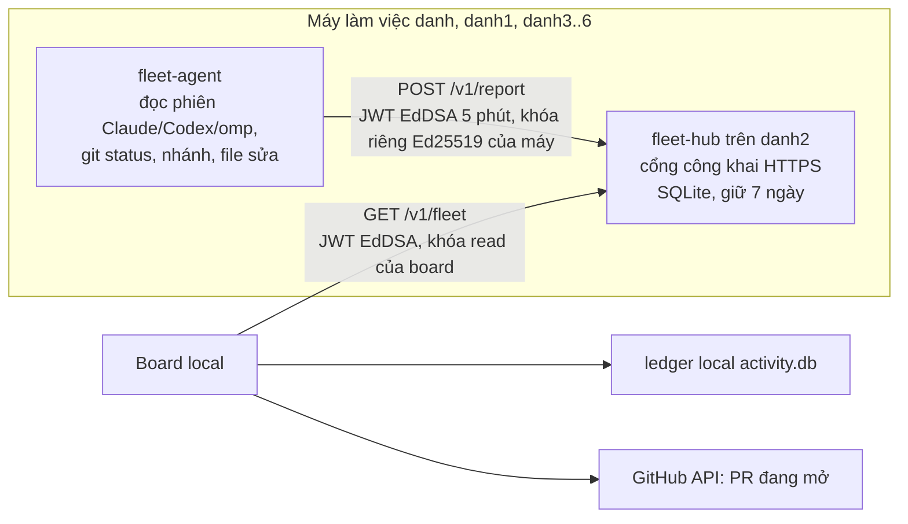

# Đề xuất: Board xem tập trung cụm máy cloud (giai đoạn 1, chỉ đọc)

Trạng thái: **đề xuất, chờ duyệt**. Chưa có code.

## Mục tiêu

Board trên máy local hiện thêm 7 máy InstaBox (`danh`, `danh1`…`danh6`):
phiên agent đang chạy, việc đang làm, nhánh, file vừa sửa, PR đang mở, và
cảnh báo khi hai máy (hoặc máy cloud và máy local) sửa trùng file.

Không làm ở giai đoạn này: mở terminal từ xa, giao việc từ board, gộp từ cloud.

## Quyết định đã chốt (người dùng, 2026-10-28)

1. Phạm vi: **chỉ đọc**.
2. Gộp: máy cloud **tạo Pull Request**, không push `main`; gộp vẫn qua
   `merge-lane.py` trên máy local. Token GitHub của máy cloud: fine-grained,
   chỉ `Contents: write` (nhánh) + `Pull requests: write`, giới hạn đúng các repo
   đồ án; `main` được chặn bằng branch protection.
3. Xác thực: **mỗi máy một khóa riêng, ký JWT ngắn hạn**.

## Ràng buộc mạng (đã kiểm)

- Board local nghe `127.0.0.1:3197`, không có địa chỉ công khai; máy cloud
  không gọi ngược vào được. `instabox port-forward` chỉ đi chiều local → cloud.
- Máy cloud không có địa chỉ công khai trừ khi `instabox port publish`.
- `danh2` đã có cổng công khai HTTPS (OpenViking) và chạy 24/24 hơn các máy khác.

=> Chọn mô hình **trạm thu trên `danh2`**:

## Xác thực

- Mỗi máy tự sinh cặp khóa **Ed25519** ngay trên máy; khóa riêng không rời máy
  (file quyền 600, hoặc `instabox secrets`), không nằm trong gói cài, không trong chat.
- `fleet-hub` chỉ giữ bảng `agent_id → khóa công khai` (role `report`). Lộ bảng
  này không giả mạo được máy nào.
- Mỗi lần gửi, agent ký JWT **EdDSA**: `iss=agent_id`, `aud=fleet-hub`,
  `role=report`, `iat`, `exp=iat+300`, `jti` ngẫu nhiên. Hub chỉ chấp nhận
  `alg=EdDSA` (từ chối `none`/HS*), kiểm chữ ký bằng khóa công khai của `iss`,
  `aud`, `exp`, lệch giờ ≤ 60 s, `jti` chưa dùng (nhớ 10 phút), `iss` khớp
  `agent_id` trong báo cáo.
- Board có cặp khóa riêng, đăng ký với role `read`: chỉ gọi được `GET /v1/fleet`.
  Khóa `report` không gọi được API đọc, khóa `read` không gửi được báo cáo.
- Thu hồi: xoá dòng `agent_id` (khóa công khai) trên hub → máy đó bị chặn ngay.
- CORS tắt (`cors_origins = []`); hub chỉ nhận JSON, giới hạn 64 KB/báo cáo,
  60 báo cáo/phút/máy.

## Dữ liệu agent gửi (không gửi nội dung code)

`{ agent_id, ts, sessions:[{engine, pid, cwd, branch, task, state, last_seen}],
   repos:[{path, branch, ahead, behind, dirty_files:[path]}] }`

Chỉ đường dẫn file và tên nhánh; không gửi diff, không gửi nội dung, không gửi
biến môi trường.

## Board

- Cột trái thêm nhóm "Cloud" theo máy; máy không báo cáo quá 10 phút hiện
  "ngủ/mất kết nối", không coi là phiên đã kết thúc.
- Cảnh báo chồng file: cùng repo + cùng đường dẫn có trong `dirty_files` của
  hai nguồn (cloud–cloud hoặc cloud–local).
- Danh sách PR mở từ máy cloud, nút "Gộp" gọi `merge-lane.py` trên máy local
  với nhánh của PR (giai đoạn 1 chỉ hiện lệnh để chạy, không tự chạy).

## Việc cần làm (sau khi duyệt)

1. `fleet-hub` (Node, SQLite) + systemd trên `danh2`, publish cổng.
2. `fleet-agent` (script nhỏ, systemd timer 30 s) trong `cloud-bundle`.
3. Nguồn `CloudFleetSource` trong `server/src` (cạnh `LedgerSource`), đọc hub.
4. UI nhóm "Cloud" + cảnh báo chồng file.
5. Test: hub từ chối JWT sai chữ ký / alg khác EdDSA / hết hạn / phát lại / agent ghi báo cáo máy khác / khóa report gọi API đọc / khóa read gửi báo cáo;
   board hiển thị máy mất kết nối.

## Rủi ro

- Hub trên `danh2` là điểm hỏng duy nhất: mất hub thì board chỉ mất phần cloud,
  phần local vẫn chạy.
- `danh2` free cũng bị dừng sau 8 giờ chạy; agent phải chịu được hub tạm mất
  (bỏ qua báo cáo, không xếp hàng vô hạn).
